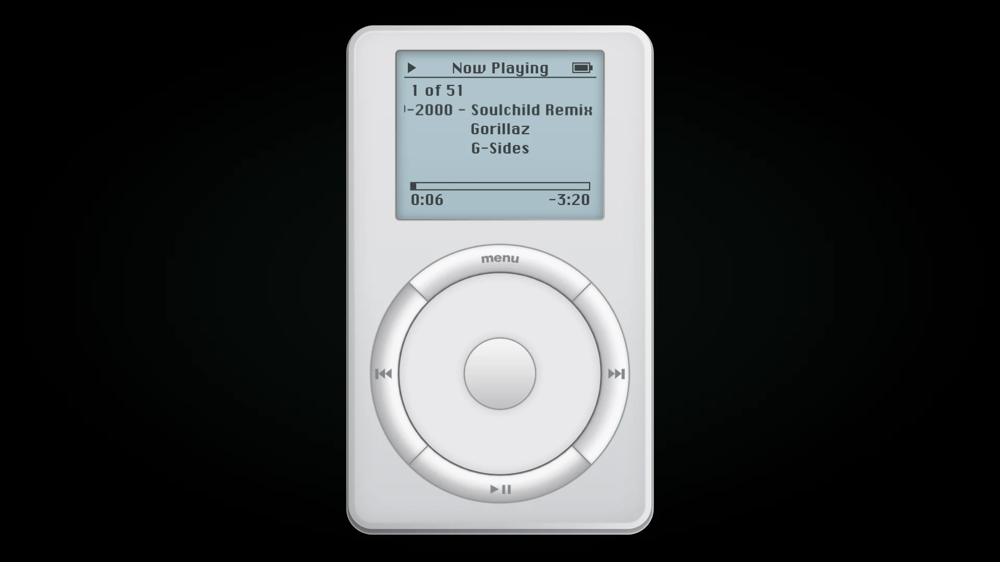
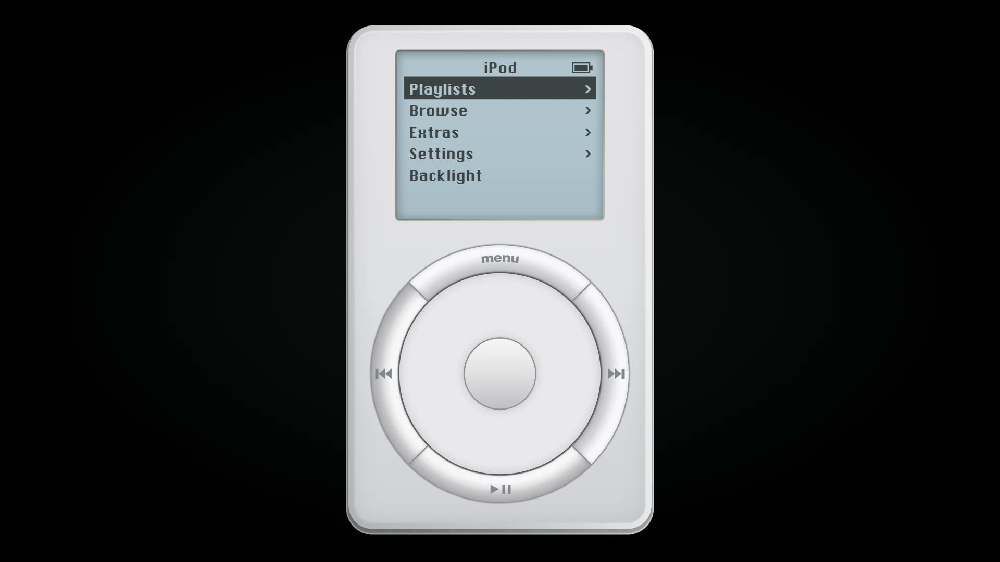

# iPod Original

The first iPod (2001) for the browser and as a desktop widget for Windows, modelled on its 1.3 software: menus, Now Playing, the scrubber, Clock and Brick.

**[Download for Windows](https://github.com/mitchivin/ipod-original/releases/latest) · [Open live demo](https://mitchivin.github.io/ipod-original/) · [Explore in DoodleDev](https://doodledev.app/)**

Current release: **1.0.1**. Free to use. Works on desktop and phone.

## Features

- **Original menus.** Playlists, Browse, Extras, Settings and Backlight, set in Chicago on the 160 × 128 mono LCD.
- **Scroll wheel.** Scroll lists, change volume and scrub through a song.
- **Now Playing.** Track count, title, artist and album, with elapsed and remaining time.
- **Extras.** Clock, Brick and Import Music for songs from your own device, plus Reconnect Folder and Clear Imports.
- **Settings.** Shuffle, Repeat, Backlight Timer, Contrast, Clicker and About.
- **Backlight.** Choose Backlight from the main menu, or hold Menu.
- **Media keys.** Play, pause and skip from your keyboard's media keys or your phone's lock screen.
- **Right-click menu.** Right-click or long-press the device for Mute, About and GitHub.
- **Desktop widget.** On Windows it's just the device on your desktop: a see-through window you drag anywhere, with a tray icon. Always on Top, Minimize and Close are in the right-click menu.

## Keyboard

| Key | Action |
| --- | --- |
| ↑ ↓ | Turn the wheel |
| ← → | Previous or next |
| Enter | Centre button |
| Esc or Backspace | Menu |
| Space | Play or pause |

## Get started

### Windows desktop widget

1. Download the **Setup installer** from [Releases](https://github.com/mitchivin/ipod-original/releases/latest) and run it.
2. The installer isn't signed, so Windows may show "Windows protected your PC". Click **More info**, then **Run anyway**.
3. The widget starts with an empty library. Choose **Extras > Import Music** to add your songs.

### Browser

1. Open the [iPod Original live demo](https://mitchivin.github.io/ipod-original/).
2. Go to **Browse > Songs** and choose a song.
3. Use the wheel and buttons to control playback.

This repository hosts the live demo, its product information and release downloads. The application source is not published here.

## Related

- [DoodleDev](https://github.com/mitchivin/doodledev)
- [iPod Classic](https://github.com/mitchivin/ipod-classic)
- [Game Boy Color](https://github.com/mitchivin/game-boy-color)
- [OP-XY](https://github.com/mitchivin/te-opxy)
- [OP-1 Field](https://github.com/mitchivin/te-op1-field)
- [Frostbolt Player](https://github.com/mitchivin/frostbolt-player)
- [MitchIvin XP](https://mitchivin.com/)

## About

Built by [Mitch Ivin](https://mitchivin.com/) in [DoodleDev](https://doodledev.app/).

iPod Original is an independent creative project and is not affiliated with Apple.

Screenshots captured at 1920 × 1080.
